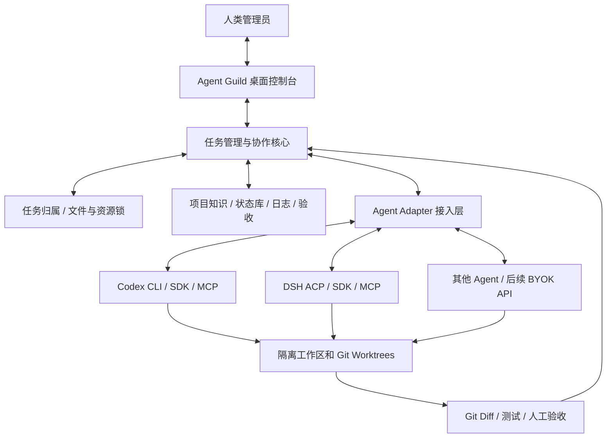

# Agent Guild（智能体公会）｜跨对话接力文档

> **更新时间：2026-11-07** · **版本：项目上下文交接 v1.0**  
> **用途：** 把本文件上传到新的 ChatGPT/Codex 对话中，即可继续产品讨论、技术调研或逐步实施。它记录的是**已经讨论过的产品需求和候选技术路线**，不代表软件已经开发出来。  
> **项目状态：需求与架构探索中；未完成最终选型、代码开发、安装部署或端到端验证。**  
> Notion 主记录：[Agent Guild 项目构想与需求记录](https://app.notion.com/p/4103b0f72013813293e0c3411dfc793c)

## 0. 给接手对话的说明（请先读）

我们计划开发一款**可开源分发的多 Coding Agent 桌面协作平台**，暂名 **Agent Guild**，用“冒险者公会 / 委托公告板”作为产品隐喻。它**不是重新训练或实现 GPT/DeepSeek**，而是让用户已有的 Codex、DeepSeek Harness（DSH）、Claude Code 等 Agent 在同一套项目任务、文件安全与日志制度下协作。应用不局限 FPGA，也应支持软件、前端、后端、嵌入式及科研工程。

**当前最重要的决定：第一版由人类管理员手动派遣任务，不做 Agent 自主认领；自主认领、自动派遣、主管 Agent 与 P2P 混合协作为后续目标。** 用户仍希望在看板上看到各 Agent 正在做什么、修改什么、下一步是什么，并且能实际验收。

### 新对话工作原则

1. **延续既定需求，不从零重新讨论**；对下文已确定的事项不要反复询问。
2. **明确区分“已定需求”“暂定实现建议”“未验证事项”**，尤其不要声称某个 MCP/SDK、订阅额度或开源仓库已经打通。
3. 开发前应**先查 GitHub 与官方文档**，核实仓库的现状、许可证、Windows 兼容性、接口示例，再决定复用、Fork 还是新建轻量模块；尽量避免重复造轮子。
4. 如用户要求“整理到 Notion”，**更新上方已有项目页面**，不要无故创建第二份重复页面。该项目并非课程学习笔记，不需要套用课程章节分层规则。
5. 默认中文；给可执行方案。未经明确要求，不擅自把技术候选确定为最终方案或直接创建大量代码。

## 1. 产品定位与已确定需求

**一句话：** 用户创建项目、发布委托并手动指派 Agent；Agent 在隔离工作区执行，持续报告真实进度；平台统一管理任务归属、文件锁、项目知识、短日志、代码变更、自动验证与人工验收；其他 Agent 可以低成本接力。

| 模块 | 已确定要解决的问题 | V1 边界 |
|---|---|---|
| 任务管理与派遣 | 任务 ID、目标、依赖、负责人、文件范围、验收标准（DoD） | **人工指定 Agent**，平台登记和确认归属；不强制自动领取 |
| 多 Agent 并行 | Codex/DSH/其他 Agent 可以在同项目分模块工作 | 首先验证两个 Agent，避免同一逻辑文件未经协调并发写入 |
| 文件与资源安全 | 目录/文件、端口、数据库迁移、硬件等独占资源不能冲突 | 独立 Git Worktree + 服务端统一锁、续租、过期/断线处理及合并门禁 |
| 项目背景/技术架构 | 新 Agent 不依赖旧聊天也能了解项目目标、接口与历史决策 | 任务卡 + 架构/接口/决策 + 最新接手摘要 |
| 实时看板 | 显示每个 Agent 正在做什么、当前文件、任务状态、下一步与阻塞 | 事件、Git/测试证据和 Agent 自报分别显示；不能仅信自述 |
| 统一日志与交接 | 模型不同但格式一致，且尽量省 Token | **统一短日志 v0.2**，详细证据自动保存、按需读取 |
| 自动及人工验收 | 自动测试通过 ≠ 用户实际操作可用 | 独立人工验收/拒绝/复验；GUI 可点击性等需人工测试 |
| 模型选择与协作模式 | 根据能力、质量、成本选模型，支持主管/平等/自主协作 | V1 人选；智能推荐与自治后置 |

**安全边界：** Git Worktree 只能隔离工作树，**不能自动禁止两个 Agent 在不同工作树修改同一逻辑文件**。中心锁、任务所有权和合并冲突检查不能省略。任务结束还要保存 Git Diff、测试结果与风险，不能仅凭 Agent 声称“完成”就通过。

## 2. 第一版的工作流程与状态

```text
创建项目（目标、架构、接口、仓库、规则）
    ↓
创建任务（任务 ID、修改范围、依赖、验收标准）
    ↓
管理员在界面中手动指定 Codex / DSH 等 Agent
    ↓
Agent 收到指派 → 校验任务归属及资源锁 → 独立 Worktree 执行
    ↓
平台更新运行事件；Agent 只报关键进展、风险与下一步
    ↓
提交 Git 变更与自动测试结果 → 其他 Agent 可审查
    ↓
必要时人类操作测试（特别是 GUI/硬件）
    ├─ 通过：归档、交接、释放资源
    └─ 不通过：保留证据、创建/退回 Bug、安排复验
```

建议状态：`Backlog → Ready → Assigned → Running → Automated Review → Human Review（按需）→ Accepted`。异常状态至少有 `Blocked / Needs Fix / Disconnected / Failed`。V1 的 `Assigned` 是**人工派遣**，不是 Agent 自主 `Claimed`。

### 验收反例

某 Agent 声称 GUI 修复成功、自动测试也通过，但人类缩小窗口后按钮仍不可点击，则任务不能标记 `Accepted`。须记录复现步骤/截图并退回修复。

## 3. 逻辑架构（已讨论；具体技术栈未拍板）



- **桌面控制台：** 公会任务板、Agent 状态、资源占用、实时活动、日志、人工验收。Electron + React + TypeScript 是**候选**，不是决定。
- **中心服务：** 原子任务指派、权限、文件/资源租约、事件持久化、断线恢复；SQLite/本地服务是**候选**。
- **Agent Adapter：** 屏蔽 Codex、DSH、Claude Code 等不同协议，统一“任务接收、执行、状态、结束/失败、日志”。MCP 适合让已运行的 Agent 读取派遣任务并上报；**MCP 本身不能启动已经关闭的客户端**。需自动唤醒时再验证受支持的 CLI/SDK/ACP。
- **模型 API：** 将来可增加类似昔涟 Agent 的 BYOK 自研 Agent Runtime，但不是 V1 前提。ChatGPT Plus/Pro 并不等于可以任意提取的通用 API Key；已有 Codex 登录和单独计费 API 是不同途径，须遵循官方授权方案。
- **可验证状态：** 进程/心跳、Git 变更、测试事件尽量由平台实际采集；无法获取时标记未知，不能伪造“真实实时”的状态。

## 4. 已确定的统一短日志模板 v0.2（Token 优化）

**核心思路：两层日志。**

- **L1：简明摘要**供人和接手 Agent 默认阅读；避免每次复制项目背景、所有文件、完整日志及工具输出。
- **L2：完整证据**由平台尽可能自动记录（文件列表、Commit/Diff、命令与测试记录、锁变更、时间戳、错误输出）；只在调查问题时按任务 ID 或证据引用按需展开。

### 标准格式

```text
[时间｜任务 ID｜Agent｜状态]      ← 平台自动填写（时间含时区）
进展：实际做了什么（1～2 句）
验证：通过 / 失败 / 未测；证据引用
问题：仅有阻塞、风险、重大接口变更时填写；无则省略
下一步：下一项最明确行动（1 句）
变更：Commit / Diff / 文件列表引用 ← 平台自动填写
```

**虚构示例：**

```text
[2026-11-07 16:30 +08:00｜T-104｜Codex｜待人工验收]
进展：修复设置窗口缩小时保存按钮被遮挡的问题。
验证：自动测试通过（test-058），尚未人工点击。
下一步：请管理员测试缩放和保存按钮。
变更：commit abc123 / diff-104
```

- 普通进度：**约 60～150 字**；任务完成/交接：**约 120～300 字**；重大失败或设计决策可写更长。只是建议，不得省略关键风险和验证状态。
- 日志不必为“仍在运行”反复生成自然语言；心跳由系统更新。需在开始、实质进展、阻塞、验收、结束/交接时记录。
- 新 Agent 默认读取：**项目背景 + 当前任务卡 + 最新交接摘要**。排错时才查 Git Diff、原始日志及过往事件。
- 所有 Agent 的报告必须映射到同一个结构化 Schema，具体 JSON Schema、字段验证器、采集接口尚未设计完成。

## 5. GitHub 参考项目：按模块对应，避免重复造轮子

以下均为**调研候选**，不是经本机实测的最终选型。准备 Fork/复制源码前应核实最新版 README、维护状态、依赖、许可证及跨平台兼容性。

| 我们需要的功能 | 参考 GitHub 项目 | 具体借鉴点 / 局限 |
|---|---|---|
| 任务看板、手动派遣、MCP 进度 | [Agent Kanban](https://github.com/graywrk/agent-kanban) | 查询/领取/进度/审核等 MCP 任务接口；研究硬派遣。它不负责唤醒已关闭的 Agent |
| 复用已登录的 Coding Agent、工作区 | [Friday](https://github.com/splashxmoon/friday) | 本地 Codex/Claude Code CLI、多会话 UI、Worktree；**仍需独立全局写锁** |
| 任务单一负责人、验收、审计 | [Retinue](https://github.com/jklthinking/retinue) | 所有权、追加式记录、审核与退回、MCP/HTTP；注意仓库当前 AGPL-3.0-only，早期版本许可证可能不同 |
| 桌面 UI、Agent 循环、模型适配 | [Cyrene-Agent（昔涟）](https://github.com/Playa-Cyrene/Cyrene-Agent) | Electron/React、Harness、Vendors、Tools、AG-UI 事件；角色和美术资产不要当作可自由复用的开源资产 |
| 任务触发唤醒、心跳与审批 | [Paperclip](https://github.com/paperclipai/paperclip) | 任务触发、执行器 Adapter、heartbeat、人工批准；V1 不必照搬其自动管理复杂度 |
| 长期任务依赖与持久记忆 | [Beads](https://github.com/gastownhall/beads) | 任务图/依赖与跨会话状态；不负责执行 Agent 或处理文件锁 |
| Agent 接口标准 | [Agent Client Protocol](https://github.com/agentclientprotocol/agent-client-protocol) | 会话、事件、取消、权限；ACP ≠ MCP，需要适配实际客户端支持 |
| API 模型路由（后续） | [LiteLLM](https://github.com/BerriAI/litellm) | BYOK、路由、调用与费用管理；不接管普通 ChatGPT 订阅额度 |
| 可观测性和质量分析（后续） | [Langfuse](https://github.com/langfuse/langfuse) | 执行轨迹、评估、成本；V1 可先实现轻量事件日志 |
| 多 Agent 大规模编排（远期） | [Gas Town](https://github.com/gastownhall/gastown) | 自动化协调与持久任务流程；过重，暂不作第一版依赖 |

**优先级：** 第一轮看 Agent Kanban、Friday、Retinue；第二轮看 Cyrene-Agent、Paperclip、ACP、Beads；模型网关/复杂自动调度后置。对于 Retinue 的 AGPL 许可证，若要直接复制或整合代码，必须审查开源发布义务。

## 6. V1 最小可行实验与验收

选一个**小型、可回滚的 Git 测试仓库**，不要直接允许多个 Agent 修改重要生产项目。

1. 管理员创建任务并在控制台**手动指定** Agent（优先 Codex；第二个可选 DSH）。
2. 至少有一条可验证的 Agent 接入路径：它能得到明确任务、反馈状态、交付结果；初期可通过人工把任务描述传给已打开的客户端验证工作流，但需如实标记哪些环节尚未自动化。
3. 两个 Agent 并行处理**不冲突的文件范围**；故意制造冲突时，资源管理器能阻止未经许可的同一逻辑文件写入或合并。
4. 日志按统一 v0.2 摘要生成；平台保留变更和测试证据，接手 Agent 不用重读全部历史。
5. 自动测试结果独立保存；需要人操作的功能进入人工验收，未通过可退回修复。
6. 模拟 Agent 退出、额度耗尽或失联，任务状态、锁和必要交接上下文可以恢复或安全移交。

**重要：** 本实验目前只是计划，**尚未实测成功**。不要把候选项目的宣传特性当作我们的实现成果。

## 7. 未决定的问题（下次讨论优先解决）

- 先做本地单用户桌面版，还是直接支持远程多人？（产品偏向本地开源桌面软件，但技术边界待定。）
- Codex / DSH 的**第一条真实可运行接入链**具体采用什么？先 MCP 读取指定任务，还是 CLI/SDK/ACP 主动运行？对应的认证与运行权限如何做？
- 文件锁粒度、租约、重入、崩溃回收、跨 Worktree 冲突检测如何设计？
- UI、后端、数据库和实时事件协议最后选哪个开源基座？
- 日志 Schema 与自动采集哪些字段要列为 V1 必选，哪些可后置？
- 模型能力评分、订阅接入、自主认领、复杂主管模式均是后续任务，**不要为了它们推迟 V1**。

## 8. 新对话的首个行动建议

**建议先做一次带证据的技术可行性调研，而不是立刻大规模写代码：**

- 对比 Agent Kanban、Friday、Retinue 的最新仓库和许可证；具体指出可直接复用的模块、差距与维护代价。
- 查 Codex 和 DSH 官方当前支持的 MCP / CLI / SDK / ACP 接口，给出最少配置的任务接收与回报实验（先选一条最稳的路径）。
- 实验成功后才敲定 V1 技术架构（组件图、数据流、最小数据表/日志 Schema、分阶段任务）。

### 可直接复制给新的 ChatGPT 对话的开场指令

> 我上传的是我们已讨论的 Agent Guild 项目上下文。请先完整理解文档，**不要把项目当作已完成实现，也不要重新把“自主认领”设为 V1 目标**。目前确定：开源桌面软件、管理员手动派遣、接入 Codex/DSH 等已有 Agent、独立工作区与资源锁、实时状态、精简日志 v0.2、自动及独立人工验收。技术栈和接入方式尚未验证。请先检查 GitHub 参考仓库和当前官方接口，并从“V1 最小可运行验证”开始提出可执行计划。只有在我明确让你开始写代码时才进入实际开发；后续更新记录请写入文档提供的原 Notion 页面。

---

**备注：** 本文件是跨对话交接快照，重要决策以更新后的 [Notion 主记录](https://app.notion.com/p/4103b0f72013813293e0c3411dfc793c) 和用户后续明确要求为准。
