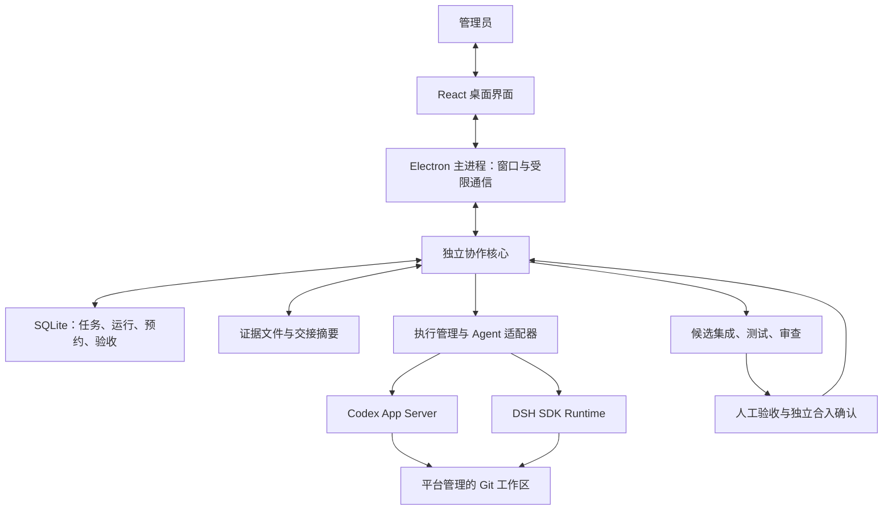

# Agent Guild V1：计划与架构总结

> 更新日期：2026-11-08 · 版本：v1.0.1（功能说明 + 专业架构设计）  
> 用途：汇总本次对话已经确认的产品边界、架构方向与实施顺序，供后续讨论和实施参考。  
> 当前状态：**计划已形成；尚未完成代码实现、安装部署或端到端验证。** 本次仅整理文档，不开发软件。  
> 技术接入说明沿用前次对话的官方资料核查结果，不能视为本机已测试成功。

**阅读顺序：** 第 1～3 节介绍功能与总体架构；第 4～7 节记录协作规则和实施计划；第 8～12 节为面向开发者的专业技术补充。专业补充中的实体字段、内部接口名和状态枚举属于**建议设计，尚待实现**，不表示用户已逐字段确认，也不代表厂商 SDK 的真实接口名称。

## 1. 用一句话理解这个软件

**你在一个窗口里给多个 AI 助手派活、看进度、处理问题和验收；软件负责组织协作、保存记录，并检查修改能否合回项目。**

你是管理员，Codex、DSH 等是执行任务的助手。第一版由你决定谁干什么，平台负责启动和管理对应的执行过程。

### 从功能上看，第一版做六件事

| 功能 | 你可以做什么 | 软件负责什么 |
|---|---|---|
| 建项目 | 选择代码仓库，填写项目说明和规则 | 保存共同背景，让后续 Agent 能接手 |
| 派任务 | 写清目标、修改范围和验收标准，指定作者与审查 Agent | 检查任务依赖与文件冲突，然后启动执行 |
| 看进度与交互 | 查看活动、补充说明、回答问题、授权或取消 | 汇总能获取的真实事件，保留交互记录 |
| 管文件 | 确认每项任务允许修改的范围 | 给各次执行准备独立副本，检查冲突与越界修改 |
| 留记录与接力 | 查看结果，将中断任务交给其他 Agent | 保存工作快照、简短交接说明和详细证据 |
| 验收与合入 | 实际试用、退回修复、确认合入 | 运行测试、保存审查结果，将通过的候选合回原项目 |

**完整例子：** 发布“修复保存按钮”任务 → 派给 Codex → 查看进度、回答问题 → DSH 审查 → 你实际点击测试 → 你单独确认合入。

## 2. 已经确认的决定

| 项目 | V1 决定 |
|---|---|
| 使用范围 | 本机单用户，Windows 优先；首版默认 Windows x64 |
| 桌面与界面 | Electron + React + TypeScript |
| 本地数据 | SQLite 保存结构化状态，详细输出和产物另存文件 |
| 基座选择 | 自建轻量协作核心，按模块参考开源项目，不整体 Fork Friday |
| 派遣方式 | 管理员指定 Agent，平台直接启动和管理运行 |
| 执行中交互 | 任务内轻量交互：补充说明、提问回答、审批、取消 |
| 首批执行端 | Codex 与 DSH；默认并发运行上限为 2 |
| DSH 认证 | **API Key 与账户登录两条路径都必须支持并分别验收** |
| 文件协调 | 派遣前互斥；越界变更禁止通过平台合入 |
| 人工验收 | 所有任务都需要人工验收 |
| 合入方式 | 人工验收通过后，管理员还需单独确认合入 |

## 3. 架构：界面、协作核心、执行端分开

| 部分 | 通俗解释 | 主要职责 |
|---|---|---|
| React 界面 | 你操作的控制台 | 项目、任务板、Agent 配置、活动、交互与验收 |
| Electron 主进程 | 桌面应用的外壳与入口 | 窗口、托盘、本机凭据保护，转发受限请求 |
| 协作核心 | 负责规则与记录的项目管理者 | 指派、状态、文件预约、事件持久化、验收与合入门禁 |
| Agent 适配器 | 不同执行端之间的翻译层 | 把各厂商的启动、事件、提问、审批和结束统一起来 |
| 工程验证层 | 交付检查与收件处 | 保存 Git 快照、检查差异、执行测试和管理集成候选 |

实现上采用**模块化单体**：模块职责清楚，但首版不拆成需要单独部署的网络服务。协作核心放入 Electron 的独立 `utilityProcess`，由核心统一写 SQLite，界面不能直接修改数据库或启动任意命令。

关闭窗口默认进入托盘，任务继续运行；明确退出应用时停止所属运行并保存现场。首版不提供应用完全退出后的后台执行服务。

## 4. 必须守住的协作规则

### 4.1 一项任务可以有多次执行

- **Task（任务）**保存目标、负责人、依赖、修改范围和验收要求。
- **Run（一次执行）**保存具体 Agent 进程、工作区、事件、心跳和结束原因。
- 返修、重试、换 Agent 或中断接续时创建新 Run，旧记录保留；同一任务同时只允许一个作者 Run。
- 旧 Run 的迟到事件不能改变新 Run 或任务当前状态。

任务主流程：

**待准备 → 已指派 → 执行中 → 自动验证与审查 → 人工验收 → 待合入 → 已接受**

Agent 只能提交交付，不能自行把任务标为“已接受”。进程退出、Agent 自报成功、自动测试通过，都不等于任务已经完成。实际合入成功后，任务才进入“已接受”。

### 4.2 文件预约与进程心跳分开

文件预约按“仓库标识 + Git 相对路径”管理，支持文件和目录范围。父子目录冲突也要检查；Windows 路径统一比较大小写；重命名同时检查旧、新路径。

- 启动前一次性申请全部范围，申请失败则不启动，不留下部分预约。
- 预约属于任务，保留到合入或撤回；等待人工验收、Agent 退出时不自动释放。
- 越界修改保留现场并禁止合入，调整范围后重新交付。
- 心跳超时触发异常检查，不能直接认定旧执行已经停止。
- 端口、设备等独占资源，确认旧执行停止后才能重新授予。

**保证边界：平台不派出相互冲突的写任务，越界候选不能通过平台合入。** 中心预约和 Git Worktree 不构成操作系统权限沙箱，无法承诺拦住同用户任意 shell 或外部程序的写入。

### 4.3 在管理副本中工作，验收同一个候选

运行数据、平台管理仓库及各个 Worktree 默认放在本机非同步目录，例如 `%LOCALAPPDATA%\AgentGuild`。导入项目时建立独立管理副本，**包括 Git 元数据也离开 OneDrive 等同步目录**。

交付顺序固定为：

1. 停止作者执行，保存变更并冻结作者提交。
2. 在当前目标分支基线上形成最终集成候选。
3. 对该候选执行平台测试、其他 Agent 审查和人工验收。
4. 管理员确认后，把原仓库快进到同一个候选提交。

测试、审查、人工验收和合入确认绑定同一提交编号（SHA，可理解为代码快照的唯一编号）。目标基线变化后重新生成候选、重新验收。

集成队列串行执行。原仓库有未提交修改、目标分支变化或检出状态不满足条件时，阻塞合入并保留现场，不自动清理、重置或覆盖用户文件。

### 4.4 日志简短，证据完整

沿用统一短日志 v0.2：时间、任务、Agent、状态、进展、验证、问题、下一步和变更引用。

- **摘要层：** 日常阅读与接手使用，记录关键事实。
- **证据层：** 保存 Git 差异、命令结果、测试输出、运行与预约事件，按需展开。
- 明确区分 Agent 自报、平台观察、实际测试结果和人工判断。
- 界面从已保存事件恢复，不依赖临时显示内容。
- 接续统一使用“新 Run + 工作快照 + 交接包”，不依赖厂商完整重放旧会话。
- 新 Agent 默认读取项目背景、任务卡、最新交接摘要，需要时再读取详细证据。

静默运行不等于失联；平台心跳只说明宿主仍活着，不代表模型取得了进展。

## 5. Codex、DSH 怎么接入

| 接入端 | 计划路径 | 需要注意的边界 |
|---|---|---|
| Codex | 官方 App Server，通过本机 stdio 通信 | 平台管理自己的会话，处理流式事件、提问和审批，使用官方认证机制 |
| DSH | 官方 TypeScript SDK，每 Run 独占 runtime | SDK 当前没有独立取消运行请求；停止时关闭所属 runtime，不能把超时当作已停止 |
| DSH API Key | 独立认证配置，本机保护密钥，限定交给对应执行进程 | 与账户模式分开显示、分别验证 |
| DSH 账户登录 | 官方本机 Web 登录入口 + 官方凭据服务 | 各 Run 隔离会话目录，共享 DSH 管理的账户凭据存储，Guild 不解析或导出 token |

**DSH 两种认证都属于 V1 必需能力，不能只做其中一条，也不能失败后偷偷切换另一条。** 账户退出或失效时停止相关账户运行，API Key 运行保持独立。账户路径未通过真实验证，就不能宣称 V1 达标。

适配器统一提供：能力检测、启动、事件订阅、补充输入、回答问题、审批响应、停止和结果采集。缺少的能力明确标记，不伪造支持。

Windows 使用 Job Object 管理所属进程树，验证取消、核心崩溃和应用退出后的清理。Job Object 用于生命周期管理，不作为文件权限沙箱。

SDK 与运行时采用经过验证的固定版本，不自动跟随 `latest`。

## 6. 分阶段实施与验收

| 阶段 | 要交付什么 | 进入下一阶段的条件 |
|---|---|---|
| M0：接入验证 | Codex、DSH API Key、DSH 账户三条真实链路；输入、事件、审批、停止和重启 | 三条均通过，明确支持版本和限制 |
| M1：协作核心 | Task / Run、文件预约、工作区、事件、异常现场与交接包 | 冲突派遣和越界合入能够被阻止 |
| M2：最小桌面闭环 | 任务板、Agent 配置、轻量交互、活动、证据与验收界面 | 能完成创建、派遣、交互、退回、验收和合入 |
| M3：双 Agent 验收 | 不同范围并行、交叉审查、返修、失联接续和 Windows 打包 | 完整场景可复现，安装包环境验证通过 |

### 必测场景

1. 同文件或父子目录被两个任务同时申请，只允许一个启动，失败方没有残留预约。
2. 越界新增、修改、删除或重命名，均禁止合入。
3. 人工验收期间预约仍有效；返修产生新 Run。
4. Agent 退出、核心崩溃、应用退出后，受管进程得到清理，现场可以接续。
5. 旧 Run 的迟到事件不能更改新执行或任务状态。
6. Agent 自报成功，但平台测试失败或人工拒绝，任务不能完成。
7. 验收后目标基线变化，旧验收失效；原仓库有未提交修改时禁止覆盖。
8. DSH 两种认证分别覆盖成功、失效和重启；账户还覆盖取消登录、登出和重新登录，不自动回退 API Key。
9. 中文及空格路径、两个并行运行、Windows 安装包中的进程与数据库组件正常工作。

## 7. 后置事项与下一步

以下不作为 V1 目标：远程多人协作、自动选人、自主认领、自研 Agent Runtime、完整终端，以及重型模型网关与评估平台。

参考项目只按模块借鉴：Friday 的执行适配与 Git 管理、Agent Kanban 的任务服务分层、Retinue 的所有权与审计理念。核心状态由 Guild 统一维护，不拼接多个完整任务平台；首版不复制 Retinue 当前的 AGPL 源码。

**后续进入实施时，第一件事是 M0：在小型测试仓库里验证三条接入链路，重点检查强制停止后的进程清理和工作恢复。** 如继续讨论产品，则先画主界面草图，把六项核心功能放到可理解的操作流程中。

## 8. 专业补充：领域模型与数据职责

### 8.1 核心领域对象

下表为建议的最小领域模型。字段用于说明职责与关联，不是已经创建的数据库结构。

| 对象 | 建议保留的信息 | 关键约束 |
|---|---|---|
| Project | 项目 ID、原仓库路径与唯一标识、管理副本、目标分支、验证命令、背景文档引用 | 同一原仓库不能通过重复导入绕过资源协调 |
| AgentProfile | 类型、运行路径、支持版本、模型、认证方式、凭据引用、能力检测结果 | 认证方式明确；凭据正文不写入普通配置或事件 |
| Task | 目标、作者、审查者、依赖、文件范围、完成定义、状态、当前 Run、执行代次 | 只有核心可以按规则迁移状态 |
| Run | 所属任务、角色、Agent 配置、工作区、厂商会话标识、状态、开始与结束时间、退出原因 | 一次执行对应一个 Run；重试与接续创建新 Run |
| Workspace | 所属 Run、路径、分支、起始提交、用途 | 作者、审查和集成工作区职责分开 |
| Reservation | 资源键、文件或目录范围、持有任务、关联执行、有效状态、释放原因 | 文件预约属于任务；运行资源不能仅因超时就重新授予 |
| Candidate | 作者提交、目标基线、最终集成提交、构建状态、失效原因 | 候选一旦冻结，不原地改写为另一份内容 |
| Interaction | 提问或审批类型、所属 Run、请求标识、问题内容、状态、回答记录 | 只接收仍有效请求的回答，迟到回答不能授权新操作 |
| Event | 顺序号、任务和 Run、执行代次、来源、事件类型、时间、证据引用 | 已保存事件用于追溯与界面重放 |
| Evidence | 所属 Run 或候选、类型、命令、工作目录、退出码、输出或产物引用 | 验证证据绑定实际执行和代码快照 |
| Review | 候选、审查角色、结论、发现、人工验收记录 | 自动审查和人工判断分别记录 |
| MergeAttempt | 候选、预期目标基线、用户确认、执行阶段、实际结果 | 用于处理 Git 操作与数据库提交之间的崩溃窗口 |

任务、预约、状态迁移和关键事件在同一个 SQLite 事务中更新。大型证据存文件，数据库记录引用和完整性信息；证据缺失时明确显示缺失，不继续宣称验证可追溯。

### 8.2 三类状态分开管理

| 状态对象 | 建议主路径 | 状态含义 |
|---|---|---|
| Task | Ready → Assigned → InProgress → AutoReview → HumanReview → ReadyToMerge → Accepted | 描述任务交付与验收所处阶段 |
| Run | Queued → Starting → Running / AwaitingInput → Stopping → 结束 | 描述执行生命周期；结束区分 Succeeded、Failed、Cancelled、Interrupted |
| Candidate | Building → Validating → AwaitingHuman → Approved → Merged | 描述具体代码快照；另有 Rejected、Invalidated |

- Task 可进入 NeedsFix、Blocked 或 Cancelled，原因单独记录；恢复时由核心检查条件再迁移。
- Run 的 Succeeded 仅表示本次执行正常结束并提供交付材料，不表示测试、人验或合入通过。
- 连接异常与“已停止”不是同一件事。无法确认进程退出时进入恢复核对阶段，保持相关资源冻结。
- Candidate 在测试失败或验收拒绝时进入 Rejected；基线、范围或候选内容改变后，原候选进入 Invalidated，不能沿用原批准。

## 9. 专业补充：模块接口与通信边界

### 9.1 模块依赖方向

建议按以下职责组织代码，避免业务规则散落在界面和厂商适配器中：

**调用流程：桌面界面 → 应用服务 → 领域规则；应用服务通过接口调用数据与外部执行能力。**

代码依赖指向核心声明的接口：SQLite、Git、进程管理和厂商适配器实现这些接口。领域规则负责状态迁移、归属、范围冲突和验收条件，不直接依赖 React、SQLite 或厂商 SDK。

Electron 主进程提供有限的系统能力；协作核心在独立进程中维护应用服务。首版核心通过 IPC 通信，不对外提供通用 HTTP 服务。DSH 官方登录助手使用本机回环地址，是单独管理的认证组件。

### 9.2 平台内部命令

以下名称是 **Guild 内部接口建议**，不是 Codex 或 DSH 的原生方法。

| 内部命令 | 主要输入 | 核心行为 |
|---|---|---|
| projects.import | 原仓库、目标分支、项目说明 | 识别仓库、建立管理副本、保存项目配置 |
| tasks.create / assign | 目标、范围、依赖、验收要求、作者和审查者 | 创建任务并记录管理员派遣决定 |
| runs.start | 任务 ID、Agent 配置、启动请求标识 | 校验前置条件，预约范围，登记并启动 Run |
| runs.sendInput | Run、补充内容 | 按适配器实际能力发送；不支持的输入方式明确返回 |
| interactions.respond | 请求标识、Run、执行代次、回答 | 校验请求仍有效，记录回答并交给对应适配器 |
| runs.stop | Run、停止原因 | 请求停止，必要时终止受管进程树并核验结果 |
| deliveries.submit | Run、交付材料引用 | 核验进程、工作区与差异，登记作者交付 |
| reviews.recordHumanDecision | 候选 ID、SHA、通过或拒绝、说明 | 写入该候选的人工验收结果 |
| merges.confirm | 候选 ID、SHA、预期目标基线 | 检查审批与目标状态，执行独立合入流程 |
| events.subscribe | 项目或任务、已读取顺序号 | 补发已保存事件并订阅后续事件 |

界面不能传入任意 SQL、任意 shell 命令或任意任务终态。请求必须经过输入校验与领域规则检查。Git 和进程参数使用结构化参数传递，避免拼接 shell 文本。

启动、提交与合入等命令使用请求标识处理重复点击和重试；已处理请求返回既有结果。**厂商侧超时不能直接自动重发 prompt**，必须先核对执行是否已被接收，避免重复执行。

### 9.3 Agent Adapter 合同

| 能力 | 适配器职责 | 核心保留的权限 |
|---|---|---|
| 探测 | 返回版本、认证状态和已验证能力 | 决定该配置能否接收任务 |
| 启动 | 在指定工作区创建本次运行，返回会话与进程信息 | 分配 Run、资源范围和执行代次 |
| 事件 | 将厂商通知映射为消息、工具活动、状态和错误 | 持久化、关联证据并维护任务状态 |
| 交互 | 转交用户输入、问题答案和单次审批决定 | 校验用户回答与当前请求匹配 |
| 停止 | 使用协议关闭或取消，配合进程管理清理 | 确认实际停止后更新状态与释放运行资源 |
| 交付 | 提供执行结果和材料线索 | 检查差异、冻结候选并启动验收 |

适配器不能自行接受任务、释放文件预约或合入代码。厂商事件中没有的信息记为未知；不能把未知用量写成零，也不能把无输出写成执行完成。

## 10. 专业补充：事务、工作区与候选集成

### 10.1 派遣采用分阶段执行与失败补偿

数据库事务只能保证数据库内的一致性，不能把创建 Worktree、启动 CLI 和写 SQLite 变成一个跨系统原子操作。建议流程如下：

1. **数据库准备：** 校验任务依赖、作者 Run 唯一性和版本；在同一事务内取得全部文件预约、登记 Starting Run、推进执行代次并写事件。
2. **外部准备：** 创建独立工作区，准备上下文、指定认证配置和受控启动参数。
3. **启动确认：** 将执行进程纳入生命周期管理，完成协议初始化；成功后记录 Running。
4. **失败补偿：** 记录失败发生阶段，确认进程是否存在，清理或隔离未完成的工作区；只有确认未使用或已经停止的运行资源才能释放。

失败任务的文件预约继续由该任务持有，便于安全重试；管理员撤回或取消任务时再走明确释放流程。核心重启后扫描未完成阶段，不能只依赖“上次命令返回成功”。

### 10.2 管理仓库与工作区

- 平台管理副本与原仓库分开，Git 对象和公共元数据也独立，不通过共享元数据把风险重新引回原仓库。
- 每个作者 Run 使用独立分支与 Worktree，记录起始提交。
- 交接保存已跟踪差异、未跟踪交付文件及其清单；快照不等于验收候选，不能直接进入 Accepted。
- 审查使用候选的独立工作区，不取得作者的写范围；出现代码修改时，该次只读审查结果无效。
- 检查差异时覆盖新增、修改、删除、重命名及未跟踪文件，并检查路径是否逃出允许工作区。

### 10.3 候选与合入门禁

每个仓库的集成队列串行构建候选。候选至少关联：作者交付、预期目标基线、最终集成 SHA、验证与审查证据、人工验收记录。

合入前同时满足：

1. 作者运行已停止，候选内容已冻结，范围检查通过。
2. 平台测试和指定 Agent 审查通过，证据对应最终集成 SHA。
3. 人工验收通过，确认的仍为同一候选。
4. 管理员单独确认合入，目标基线和原仓库状态未变化。

合入使用能够同步更新目标分支、索引与工作目录的正常 Git 流程。不能只改引用而留下旧文件；不能用强制重置或清理来掩盖状态不一致。

Git 修改与 SQLite 事务之间存在崩溃窗口，因此先保存 MergeAttempt 意图，再执行 Git，最后核对实际目标 SHA 并记录结果。重启后根据已授权候选、预期基线和实际 Git 状态对账：已经合入的记录补全；状态不明确的冻结待核查，不重复覆盖原仓库。

## 11. 专业补充：事件、恢复与本机运行

### 11.1 事件与证据来源

建议事件保留事件 ID、递增顺序号、项目、任务、Run、执行代次、来源、发生与接收时间、事件类型、关联证据和格式版本。

| 来源 | 可信含义 | 使用限制 |
|---|---|---|
| Agent 自报 | Agent 对进展与结果的陈述 | 不能直接证明测试通过或文件已正确修改 |
| 适配器通知 | 厂商协议实际发出的事件 | 不同厂商能力不同，不能推断未提供的信息 |
| 平台采集 | Git 差异、实际进程状态、平台执行的命令结果 | 必须关联采集对象、时间及具体快照 |
| 人工记录 | 用户在某候选上的操作与判断 | 不自动适用于后续修改或其他候选 |

状态表与业务事件共同更新；详细输出先做必要脱敏，再保存引用。首版采用当前状态加追加日志，不要求仅靠事件重建整个数据库的完整事件溯源系统。

### 11.2 恢复处理

| 情况 | 处理原则 |
|---|---|
| 界面刷新或渲染进程退出 | 核心继续运行，界面重新读取快照并按顺序号补齐事件 |
| CLI 静默运行 | 保留运行状态，显示最后事件时间；不因缺少文本输出自动判定失联 |
| 协议连接中断 | 核对实际进程与工具状态，不能先释放资源再调查 |
| 核心崩溃 | 清理所属进程树；恢复后核对未结束 Run、工作区和合入记录 |
| 模型额度耗尽或认证失效 | 如实记录结束原因，停止相关执行，保存交接材料 |
| 继续任务 | 在旧执行已停止后创建新 Run，从快照和交接包接续 |
| 旧事件或迟到审批 | 留在原 Run 历史中，不改变新运行状态，不授予新操作权限 |

执行代次用于拒绝旧 Run 的续租、交付和完成请求；它是核心接口的有效性检查，不是阻止旧进程写磁盘的权限机制。

### 11.3 Windows 生命周期与认证隔离

- 使用单实例入口，避免多个核心同时管理相同本地数据与资源。
- Job Object 负责受管进程树；控制句柄不能被子进程意外继承。若使用原生启动助手，核心控制通道断开时助手必须终止所属 Job。
- 验证 Job 管理与各执行端原生沙箱的兼容性；不能仅以父进程 PID 退出认定所有子进程已停止。
- 关闭窗口与明确退出的语义保持第 3 节约定；无法确认资源已释放时保留异常状态。
- API Key 使用本机保护存储，配置中只保留引用，交给对应运行进程；日志中不得写入明文密钥。
- DSH 账户凭据由官方凭据服务负责。平台管理官方登录助手、登录状态与账户 Run 的停止，不自建 token 提取或转用机制。
- 账户模式和 API Key 模式显式选择，认证错误不得触发自动换路线重试。

## 12. 专业补充：验证矩阵与工程门禁

### 12.1 M0 接入能力矩阵

以下初始结果全部为**待验证**。通过或失败必须填写使用版本、环境、步骤与证据引用；前次阅读官方文档不代替实际测试。

| 能力 | Codex | DSH API Key | DSH 账户 |
|---|---|---|---|
| 指定工作目录启动与执行 | 待验证 | 待验证 | 待验证 |
| 获取消息与工具事件 | 待验证 | 待验证 | 待验证 |
| 用户问题与权限审批 | 待验证 | 待验证 | 待验证 |
| 补充输入及不支持能力的明确反馈 | 待验证 | 待验证 | 待验证 |
| 取消、退出与子进程清理 | 待验证 | 待验证 | 待验证 |
| 中断现场保存与新 Run 接续 | 待验证 | 待验证 | 待验证 |
| 认证失效时的错误与停止 | 待验证 | 待验证 | 待验证 |
| 应用重启后的认证可用性 | 待验证 | 待验证 | 待验证 |
| 登录、取消登录、登出及重新登录 | 按官方认证另验 | 不适用 | 待验证 |
| 中文、空格路径与双并行隔离 | 待验证 | 待验证 | 待验证 |

### 12.2 验证层次

| 层次 | 必须验证的内容 |
|---|---|
| 核心规则 | 状态迁移、预约冲突、重复请求、旧执行代次、验收角色与条件 |
| 故障恢复 | Worktree 创建失败、进程启动失败、数据库记录与外部事实不一致、合入中崩溃 |
| 适配合同 | 实际协议、错误映射、事件关联、审批与取消、版本兼容 |
| 工程集成 | 受控差异、冻结候选、测试与人验同 SHA、基线变化重验、脏仓库阻塞 |
| 桌面与发行 | IPC 边界、托盘与退出、非开发环境启动、数据库组件和进程管理打包 |

首版验收必须结合第 6 节的完整场景；模拟适配器可验证核心规则，不能替代三条真实接入链路。用户可操作的界面功能仍需实际操作验收。

### 12.3 需要在 M0 固化的工程配置

已确认的产品边界与技术路线不在这里重新选择。下列具体工程配置尚未实测，应在 M0 形成有证据的实现记录：

- Electron、Codex、DSH SDK 与 runtime 的固定支持版本。
- SQLite 访问组件、迁移与一致性备份恢复方案，以及 Windows 打包结果。
- Windows 启动助手与 Job Object 的实现和清理结果。
- DSH 官方账户登录助手、共享凭据存储及账户退出联动的具体配置。
- 各适配器真实能力、暂不支持项、超时与恢复行为。

如果验证结果与计划假设冲突，记录影响并调整实现建议；不能删去 DSH 双认证、人工验收或安全合入门禁来宣称 V1 已完成。

## 13. 相关文档与资料

### 本地项目背景

- [项目构想与架构草案（2026-11-07）](Agent_Guild_项目构想与架构草案_2026-11-07.md)
- [跨对话交接文档（2026-11-07）](Agent_Guild_Handoff_2026-11-07.md)

本文件记录原文之后在对话中确认的架构决定。旧文档中“技术栈尚未选定”等描述属于当时状态；本文件已确定计划路线，但不代表完成了技术验证。后续以用户明确更新的决定为准。

### 官方接入与机制参考

- [Codex App Server](https://learn.chatgpt.com/docs/app-server)
- [DSH TypeScript SDK](https://github.com/deepseek-ai/deepseek-harness/blob/master/packages/sdk/client/README.md)
- [DSH 账户登录界面](https://github.com/deepseek-ai/deepseek-harness/blob/master/packages/client/ui-settings-account/README.md)
- [DSH 账户模型路由](https://github.com/deepseek-ai/deepseek-harness/blob/master/packages/llm/llm-deepseek-account/README.md)
- [Electron utilityProcess](https://www.electronjs.org/docs/latest/api/utility-process)
- [Git Worktree](https://git-scm.com/docs/git-worktree)
- [Windows Job Objects](https://learn.microsoft.com/en-us/windows/win32/procthread/job-objects)
