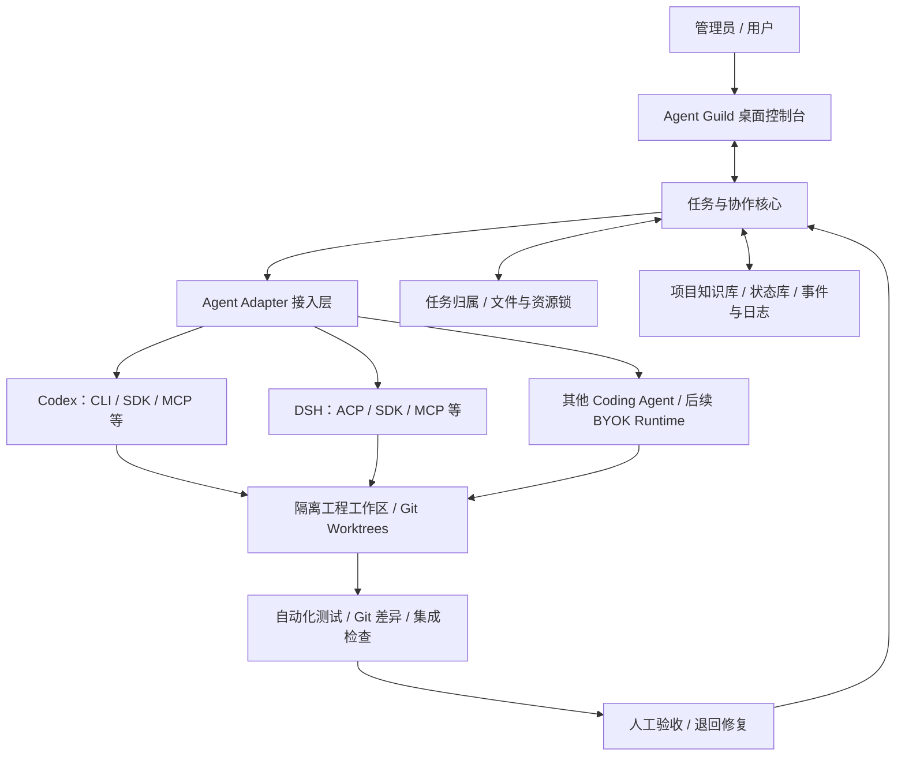

# Agent Guild：多智能体协作平台

> **项目构想与架构草案｜2026-11-07**  
> 当前阶段：需求与技术调研。**尚未完成最终选型、安装、代码实现或集成测试。**  
> 适用场景：软件工程、桌面应用、Web 系统、FPGA/嵌入式等。FPGA 只是最初案例，不是平台边界。  
> 对应 Notion：[Agent Guild 项目记录](https://app.notion.com/p/4103b0f72013813293e0c3411dfc793c)

## 1. 一句话介绍

**Agent Guild（智能体公会）**是一款拟议中的开源桌面协作软件：用户像“公会管理员”一样管理项目与任务，向 Codex、DeepSeek Harness（DSH）、Claude Code 等 Agent **手动派遣**工作；各 Agent 在独立工作区执行、持续反馈进度，平台统一管理文件锁、日志、交接、自动测试与人工验收。后续再增加自动分派和 Agent 自主认领。

“冒险家公会”首先是一套任务管理理念，可以采用适度 RPG 风格，但系统核心应是可靠的工程协作，而不是装饰性角色界面。

## 2. 要解决的问题

- **多 Agent 并行而不互相覆盖：** A 修改某文件时，B 不能未经许可修改同一逻辑文件；除了文件，也要考虑端口、服务、测试设备等独占资源。
- **新 Agent 能快速接手：** 项目背景、技术架构、接口规范、决策、任务状态和下一步必须持久化。
- **进度可见：** 清楚展示每个 Agent 当前做什么、正在处理的文件、阻塞情况与下一步。
- **验收可信：** 自动测试与人工实际操作测试分开；Agent 自称“完成”不等于人类确认通过。
- **跨厂商日志一致且省 Token：** 简明摘要用于日常阅读，Git Diff、测试结果和原始操作事件作为按需查看的证据。
- **不绑死模型厂商：** 既可调度已有 Coding Agent 客户端，也可在后续支持用户自带 API Key 的自研 Agent Runtime。

## 3. 已明确的产品策略

| 维度 | V1（优先实现） | 未来扩展 |
|---|---|---|
| 任务分配 | **管理员手动派遣**给指定 Agent | 能力推荐、自动派遣、自主认领 |
| 协作模式 | 明确负责人，允许多个 Agent 执行不同任务 | Supervisor–Worker、P2P、混合拓扑 |
| 执行端 | 优先复用本地已登录的 Codex、DSH 等，通过可用适配接口接入 | 自研 Agent Runtime、更多厂商/本地模型 |
| 工作安全 | Git Worktree + 统一资源锁 + 合并审查 | 更细粒度的冲突预测、动态调度 |
| 日志 | 统一简明日志 v0.2 + 详细证据 | 智能摘要、跨任务检索和长期记忆 |
| 验收 | 自动验证 + 独立人工验收队列 | 规则化质量门禁、回归验收自动安排 |

**重要边界：** ChatGPT Plus/Pro 套餐不是可以任意提取的通用 OpenAI API Key。直接运行已有 Codex 客户端和使用普通独立计费的模型 API，是不同接入方式；具体授权、用量与能力以官方渠道和实际接口测试为准。

## 4. 逻辑架构



这是**逻辑分层**而非已经决定的软件依赖。当前候选技术为 Electron + React + TypeScript（桌面与 UI）、本地服务和 SQLite（状态持久化）、MCP/CLI/SDK/ACP（适配）、Git Worktree（隔离）；但最终框架和数据库尚未拍板。

### 核心模块职责

1. **公会控制台：** 项目列表、任务公告板、Agent 名册、实时状态、日志时间线、资源锁、人工验收。
2. **任务管理器：** 任务 ID、负责人、优先级、依赖、工作范围、完成定义（DoD）、手动派遣与撤回。
3. **Agent 接入层：** 将不同 CLI、SDK、ACP 和 MCP 接口统一映射为“接收任务—执行—事件—结束/失败”；MCP 本身不会唤醒已关闭的客户端。
4. **资源协调器：** 原子写入权限、文件/目录/服务的租约锁、续期/超时、异常接管，检查跨 Worktree 的冲突。
5. **证据与日志层：** 事件流、文件变更、Git Commit、测试记录、交接快照和精简摘要。
6. **验收中心：** 自动化测试结果、人工操作清单、Bug 退回、复验、最终批准。

**特别注意：** Git Worktree 只是工作目录隔离，不能自动保证不同工作树中不修改同一路径。需要额外的中心资源锁、提交前审查和合并冲突处理。

## 5. 第一版任务生命周期

```text
创建项目及背景
  ↓
管理员发布任务（目标、范围、验收标准）
  ↓
管理员手动选定 Agent 并派遣
  ↓
Agent 接收任务 → 检查权限/资源锁 → 独立工作区执行
  ↓
更新实时状态与短日志；证据由平台尽量自动采集
  ↓
提交代码 / Git Diff / 自动测试结果
  ↓
独立审查 → 必要时人工实际操作验收
  ↓
通过：归档并释放资源 ｜ 失败：生成 Bug、退回修复
```

建议任务状态：`Backlog → Ready → Assigned → Running → Automated Review → Human Review（按需）→ Accepted`；异常状态包括 `Blocked / Needs Fix / Disconnected / Failed`。

### 人工验收举例

Agent 认为上位机 UI 已修好，自动测试也通过，但人类缩小窗口后发现“保存”按钮无法点击。此时**不能直接将任务标记完成**；管理员应在验收项中记录复现步骤、截图/录像、期望结果，退回为 Bug 修复任务并安排复验。

## 6. 统一精简日志规范 v0.2

理念：**Agent 写少量关键事实，系统存完整可验证证据；其他 Agent 默认只读摘要，需要排错时才展开历史。**

```text
[时间｜任务 ID｜Agent｜状态]       ← 平台自动填
进展：本次实际完成/修改了什么（1～2 句）
验证：通过/失败/未测；证据引用
问题：仅在有阻塞、接口变化或风险时填写
下一步：最明确的一项行动（1 句）
变更：Commit / Diff / 文件列表引用 ← 平台自动填
```

**虚构示例：**

```text
[2026-11-07 16:30 +08:00｜T-104｜Codex｜待人工验收]
进展：修复设置页窗口缩小时保存按钮被遮挡的问题。
验证：GUI 自动测试通过（test-058）；尚未人工点击。
下一步：管理员测试缩放与保存按钮。
变更：commit abc123 / diff-104
```

- 普通更新：建议 **60～150 中文字**；完成/交接：建议 **120～300 字**；重要异常或决策按实际情况展开。这是软预算，不牺牲正确性。
- 时间戳、身份、任务 ID、Commit、文件差异、测试执行、锁事件**尽可能由平台采集**；采集不到就标记未知，不能伪造。
- 不复制长堆栈、完整 Diff、每一步工具输出；原始证据存储后用 ID/链接引用。
- 只在开始、关键进度、阻塞、提交、交接等事件生成自然语言摘要；“仍在运行”由心跳更新，不反复消耗模型 Token。
- 新 Agent 默认读取 **项目背景 + 当前任务卡 + 最近一次交接摘要**。需要细节时再查询关联日志/Commit。
- 不同模型必须映射到统一的日志 Schema。机器字段格式、验收验证器属于待实现内容。

## 7. GitHub 开源参考：每个模块看哪一个

下表根据截至 **2026-11-07** 的公开仓库文档整理，**是参考路线，不是已安装成功或完全满足需求的结论**。

| 功能方向 | 参考项目 | 可借鉴的具体能力 | 局限 / 注意 |
|---|---|---|---|
| **手动派遣、任务看板、MCP 进度** | [Agent Kanban](https://github.com/graywrk/agent-kanban) | `get_next_task`、`claim_task`、`post_progress`、`request_review`；也有指定 Agent 的 hard assignment | 服务端被动提供任务，不自动启动 Agent；它的自主认领是未来可用能力，V1 先关注硬分配 |
| **接入已登录的 Codex/Claude、Worktree、协作 UI** | [Friday](https://github.com/splashxmoon/friday) | 使用已有本地 Coding CLI 与登录、协作会话、Git Worktree、相互审查与交接 | 需要独立验证兼容性；Worktree 不是全局文件锁 |
| **任务所有权、操作审计、验收** | [Retinue](https://github.com/jklthinking/retinue) | 单任务持有人、仅持有人写入、追加式回执、接受/退回、MCP/HTTP 接口 | 当前源码 **AGPL-3.0-only**；0.3.0a4 及更早发布版本仍为 MIT，复用需做许可证审查 |
| **桌面框架、模型适配、Agent 事件** | [Cyrene-Agent / 昔涟](https://github.com/Playa-Cyrene/Cyrene-Agent) | Electron + React、`CyreneHarness`、`vendors`、`tools`、AG-UI 事件、MCP | 主要是桌面个人智能体；不要直接使用不属于开源许可的角色/美术资产 |
| **唤醒、Agent 心跳、审批及状态跟踪** | [Paperclip](https://github.com/paperclipai/paperclip) | Agent Adapter、任务分配触发 wakeup、heartbeat、人工批准和运行记录 | 组织管理更偏自动化，第一版不必照搬整套复杂流程 |
| **任务依赖与持久记忆** | [Beads](https://github.com/gastownhall/beads) | 任务图、`bd ready`、依赖管理及长任务跨会话状态 | 不替代 Agent 执行、文件锁与 GUI |
| **Agent 通信协议** | [Agent Client Protocol](https://github.com/agentclientprotocol/agent-client-protocol) | 会话启动/恢复、`session/update`、取消、权限请求 | ACP 与 MCP 职责不同；按实际 Agent 支持情况接入 |
| **模型 API 路由与成本（未来）** | [LiteLLM](https://github.com/BerriAI/litellm) | 多模型 API 兼容接口、路由、负载均衡、成本追踪 | 仅对经其网关的调用生效，不负责接管用户的 Codex 订阅客户端 |
| **可观测性与质量评估（未来）** | [Langfuse](https://github.com/langfuse/langfuse) | Traces、评估、用量与成本分析 | V1 可以先做最小事件日志，不一定需要部署完整平台 |
| **大规模调度（远期）** | [Gas Town](https://github.com/gastownhall/gastown) | 复杂多 Agent 编排与持久任务工作流 | 部署和认知成本较高，暂不优先 |

### 推荐研究顺序

**第一梯队（现在看）**：Agent Kanban、Friday、Retinue。先验证任务派遣、接入已有编程客户端、唯一任务负责人、进度和审计。  
**第二梯队（按需看）**：Cyrene-Agent、Paperclip、ACP、Beads。解决桌面交互、事件流、可恢复会话与依赖。  
**第三梯队（后续看）**：LiteLLM、Langfuse、Gas Town。等基础闭环成立再引入更重的网关、评估与自治系统。

**许可证提醒：** 参考实现、借鉴理念与直接复制/修改源码是三件不同的事。选择具体代码作为基础前应逐项核对 LICENSE、第三方依赖与发布义务；尤其注意 Retinue 的版本差异。

## 8. MVP 验收标准

第一版不追求 Agent 全自动自主接单，而是先让**两种不同来源的 Agent**完成一个可复现项目闭环：

1. 管理员可在看板中创建任务并**手动派遣**给指定 Agent。
2. Agent 能通过受支持方式读取任务，反馈当前工作及下一步；状态不会因为客户端关闭而永久显示“运行中”。
3. 两个 Agent 不会未经协调同时写入同一逻辑文件；异常断连后锁可安全恢复或接管。
4. 每次执行产生统一短日志，变更与测试证据可按需回溯；不要求新 Agent 阅读所有历史。
5. 能自动验证，并提供独立人工验收；不通过可退回并形成 Bug 任务。
6. Agent 退出或额度耗尽后，其他 Agent 能根据项目背景、任务状态和交接摘要接续工作。

## 9. 尚待确定的技术问题

- 平台第一版是仅本机单用户，还是支持局域网/远程多人协作？
- 如何把“派遣”变成 Codex/DSH 实际接收：初期从客户端读取被分配任务，还是由平台通过 CLI/SDK 主动唤醒？两者可分阶段。
- 资源锁粒度（文件/目录/服务）、租约过期与异常回收规则、跨 Worktree 合并门禁如何实现？
- 最小数据库、UI 事件流和 API 协议采用什么技术？
- 如何管理 API Key、本地权限、运行沙箱与敏感日志？
- 日志 Schema、事件采集范围、验收门槛与 Token 成本的实际测试指标如何定义？
- 平台最终是改造现有开源项目、组合几个模块，还是自建轻量核心？**目前尚未决定。**

---

**建议的下一步：** 用一个最小 Git 测试仓库，验证「管理员手动派遣 → Codex 执行并汇报 → DSH 审查 → 人工验收 → 统一日志归档」，同时检查任务与文件锁是否可靠。实验跑通之后，再决定最终技术选型。
