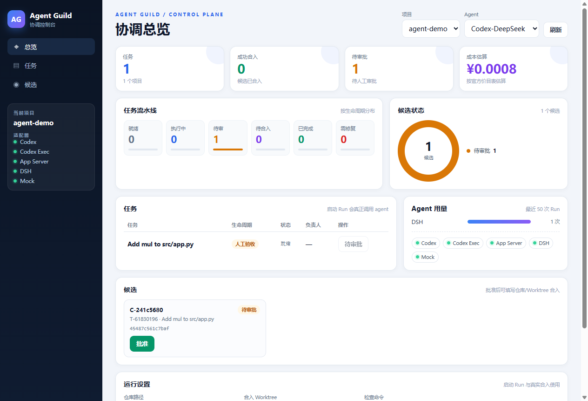

# Agent Guild WebView2 壳



这是 Electron 的替代桌面壳。  
本机 Electron 17/22/28/45/46-alpha 都在启动阶段崩 `0xC0000005`，但 Edge/WebView2 正常，所以改用 WebView2。

## 直接运行

```powershell
cd p0-coordinator\webview2
.\bin\AgentGuildWebView2.exe
```

如果 PowerShell 执行策略拦截脚本，用上面的 exe 直接启动即可。  
也可以：

```powershell
powershell -NoProfile -ExecutionPolicy Bypass -File .\run.ps1
```

需要 Microsoft Edge WebView2 Runtime（Windows 11 自带；Windows 10 通常随 Edge 安装）。

## 验证

```powershell
.\bin\AgentGuildWebView2Cli.exe --smoke
```

期望：

```text
WEBVIEW2_SMOKE {"smoke":true,"data":[...projects...]}
```

说明：

- 窗口创建成功；
- WebView2 初始化成功；
- 现有 `electron/renderer` 页面加载成功；
- 注入的 `window.guild.rpc` 桥成功；
- Python `worker_cli.py projects` 返回真实数据。

## 功能

- 项目下拉；
- 任务表 + **启动 Run**（真正启动选中 agent）；
- 候选表；
- **批准**（awaiting_human）；
- **合入**（approved，真实 cherry-pick + finish_merge）；
- 刷新；
- RPC：`projects` / `status` / `candidates` / `start_run` / `approve` / `merge` / `adapters`。

`start_run` 现在会调用 `worker_cli.py start-agent`：

```text
start execution
→ 启动 adapter（Codex-DeepSeek / 智谱 / App Server / DSH）
→ 等完成
→ scope check
→ 清理 __pycache__
→ commit → Candidate
→ 可选 check → evidence → awaiting_human
```

边界：

- 需要任务**已有 active workspace**；
- `check` 为空时，Candidate 停在 `building`，不会自动进人工审批；
- DSH 用独立 `DSH_HOME`（`.tmp/dsh-ui-home`），已验证 UI 启动；
- Merge 走 `merge_candidate_git()`，会真实 cherry-pick、失败回滚。

## 真实启动 agent

```powershell
cd p0-coordinator
python ..\pilot\seed_agent_task.py
```

记下 `db` / `task_id` / `repo` / `worktree_for_merge`，然后：

```powershell
$env:GUILD_DB="...\agent-demo\db.sqlite"
$env:DEEPSEEK_API_KEY="sk-..."
cd webview2
.\bin\AgentGuildWebView2.exe
```

在 UI 里：

1. 选任务；
2. agent 选 **Codex-DeepSeek** 或 **DSH**；
3. check 填 `python -m py_compile src/app.py`；
4. 点 **启动 Run**；
5. 等候选变成 `awaiting_human`；
6. 点 **批准**；
7. 填 repo / worktree；
8. 点 **合入**。

## 用种子数据试

```powershell
cd p0-coordinator
python ..\pilot\seed_webview2.py
```

记下输出的 `db`、`candidate_id`、`repo`、`worktree_for_merge`，然后：

```powershell
$env:GUILD_DB="...\webview2-demo\db.sqlite"
cd webview2
.\bin\AgentGuildWebView2.exe
```

在 UI 里：

1. 点候选的 **批准**；
2. 填 repo / worktree；
3. 点 **合入**；
4. 看到 `已合入: <sha>`。

## 命令行自测

```powershell
$env:GUILD_DB="...\webview2-demo\db.sqlite"
.\bin\AgentGuildWebView2Cli.exe --call candidates
.\bin\AgentGuildWebView2Cli.exe --call approve --candidate C-xxxx
.\bin\AgentGuildWebView2Cli.exe --call merge --candidate C-xxxx --repo-path ... --worktree ...
```

## 结构

```text
webview2/
├─ Program.cs        # WinForms + WebView2 + JSON-RPC 桥
├─ build.ps1         # 下载 WebView2 SDK + csc 编译
├─ run.ps1
├─ bin/              # 预编译 exe + WebView2 DLL
└─ README.md
```

## 为什么不用 Electron

本机 Electron 崩溃证据：

- [../../pilot/ELECTRON-BLOCKED.md](../../pilot/ELECTRON-BLOCKED.md)

WebView2 用 Edge 的 Chromium，绕开 Electron 运行时。

## 与 Electron 的关系

- `electron/` 保留，供能跑 Electron 的机器使用；
- `webview2/` 是本机可用的桌面壳；
- 两者共用 `electron/renderer` 的 HTML/CSS/JS 和 Python CLI 桥思路。
