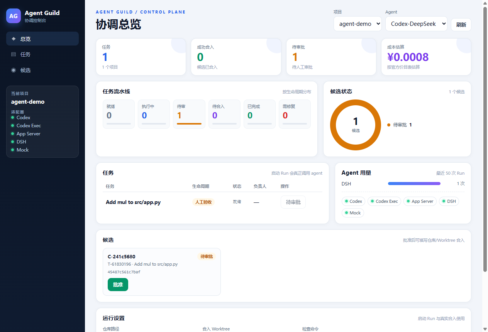

# Agent Guild 当前状态报告

**日期**：2026-11-09  
**阶段**：B 内部试点 · V2 Phase 1 完成，Phase 2/3 首批能力落地  
**定位**：单机多 agent 协作原型，不是生产平台

---

## 0. 结论

Agent Guild 已经从“协调内核原型”推进到：

> **真实仓库可重复试点 + 真实 Git 合入 + OR 选 agent + 多角色审批门禁**

当前可以完整演示：

```text
任务 → 文件预约 → worktree → 真实 agent
→ scope 检查 → Candidate → Evidence
→ 人工批准（可多级）→ 真实 cherry-pick
→ 合并后检查 → integration 测试通过 → accepted
```

仍然不是生产系统：没有真实身份认证、没有多租户、没有远程 push/PR、没有依赖感知的全局排期。

---

## 1. 这套东西是什么

Agent Guild 是**多 agent 编程的调度台 + 安全合入流程**：

- 人类定目标、审批、确认合入；
- Coordinator 管任务、文件预约、租约、生命周期、预算和审计；
- Agent 在独立 worktree 内工作，只能改预约范围；
- 产物是 Candidate + Evidence，不是直接改主分支；
- 人类批准后，系统执行真实 Git cherry-pick。

它不解决“模型更聪明”，解决的是：

- 多 agent 不互相踩文件；
- 不越界修改；
- 不自行合入；
- 每个结果有 SHA、有检查、有审批、有记录。

---

## 2. 能力与状态

| 能力 | 状态 | 说明 |
|---|---|---|
| 协调内核 | 完成 | SQLite、任务/写集/依赖、租约/TTL/fencing、文件预约、事件 |
| V1 执行闭环 | 完成 | Execution、Candidate、Evidence、MergeAttempt、Workspace、lifecycle |
| 真实 Git 合入 | 完成 | cherry-pick、冲突回滚、合并后检查 |
| Adapter | 完成 | DSH、Codex-DeepSeek、Codex-智谱、Codex App Server |
| WebView2 控制台 | 可用 | 启动 Run、批准、合入、流水线/候选/用量可视化 |
| OR 路由 | 首批完成 | cost/time/quality 单任务推荐；预算约束批量分配 |
| 语义/能力标签 | 首批完成 | AST diff、breaking 门禁、影响面/ACK、能力标签 |
| 多用户/角色 | 首批完成 | reviewer/admin、项目级 admin 门禁、多级审批链；**不是认证** |
| Electron | 阻塞 | 本机启动阶段 0xC0000005；WebView2 替代 |
| A2A / 动态组织 | 未开始 | 当前是 Coordinator 中介的间接协作 |
| 文档内核 / 学习 | 未开始 | 报告是产物，不是运行时内核 |

---

## 3. 已验证的证据

### 3.1 测试

```text
91 tests OK
```

覆盖协调器、租约、预约、MILP/Pareto、验证器、V1 生命周期、真实 Git 合并、Adapter、OR 路由、审批角色与多级链。

### 3.2 真实仓库试点

| 项 | 值 |
|---|---|
| 任务 | `T-42d29c0b` — Add mul and div with tests |
| Agent | Codex-DeepSeek |
| 修改文件 | `src/calc/ops.py`、`tests/test_ops.py` |
| Candidate | `C-2c0b3836` |
| Candidate SHA | `4bb45b7e384bf0bfac8eea6c09165a0bcaddf04f` |
| 合并结果 | `96e5f737860a3068de7562bb9d01d766c21ef946` |
| 合并后检查 | `REAL_REPO_CHECK_OK` |
| integration 测试 | 4 个单元测试全绿 |
| 负向验证 | 检查失败回滚测试通过 |

基线检查是失败的（`ImportError: div`），agent 完成后才通过；这是有意设计的“先红后绿”门禁。

### 3.3 UI 合入后检查

WebView2 的「合入」会把检查命令传给 `merge-candidate-git --check`。

实测：

```text
candidate C-a47c2215
result_sha 51358a57...
check_exit 0
merge_attempt succeeded
```

### 3.4 OR 实测

Auto 推荐选中 DSH：

```text
task T-e282ee16
strategy time
agent dsh
duration 16.6s
candidate C-4aa9f055
estimated_cost_usd 0.000766
```

批量分配（4 任务，预算 $0.01）：

```text
dsh            $0.001
codex-deepseek $0.006
其余任务：剩余预算不足
```

### 3.5 语义与组织 MVP

- Python AST 提取 added/removed/signature/body；
- breaking change 必须 admin 批准；
- 影响面按 write_set/显式语义依赖返回，支持 ACK；
- Agent 能力标签落库，OR 支持 `--require-tag` 过滤。

### 3.6 审批策略实测

admin-only 项目：

```text
reviewer=blocked project requires admin approval; got reviewer
admin=approved admin
merge_attempt=pending
```

多级链 `reviewer,admin`：

- reviewer 批准后仍是 `awaiting_human`，`pending_roles=["admin"]`；
- admin 批准后才变 `approved`。

---

## 4. 当前架构

```text
Human / Admin
   │  目标、审批、合入确认
   ▼
WebView2 控制台
   │  JSON-RPC
   ▼
Coordinator（SQLite）
   │  任务 / 预约 / 租约 / 生命周期 / 预算 / 审计
   ▼
Agent Adapter（DSH / Codex / App Server）
   │  独立 worktree，只改预约文件
   ▼
Candidate + Evidence（SHA 绑定）
   │  人工批准（可 reviewer → admin）
   ▼
Integration worktree
   │  git cherry-pick + 合并后检查
   ▼
Accepted
```

关键原则：

- agent 不能直接改主仓库；
- agent 不能自行合入；
- 人类保留最终批准权；
- 批准的是具体 SHA，不是移动分支。

---

## 5. 控制台



当前控制台提供：

- 任务流水线：就绪/执行中/待审/待合入/已完成/需修复；
- 候选状态环形图；
- Agent 用量；
- Adapter 状态；
- 启动 Run（支持 Auto OR 推荐）；
- 批准（Reviewer/Admin）；
- 合入（带仓库、worktree、检查命令）；
- 任务行动作按状态锁定，避免重复启动。

报告生成时 WebView2 进程仍在运行（PID 40884），数据库为 `.tmp/agent-demo/db.sqlite`。

---

## 6. 边界与风险

| 边界 | 现状 |
|---|---|
| 部署 | 单机、SQLite |
| 用户 | 单操作者；角色是审计标签 + 门禁，不是认证 |
| 合入 | 合到 integration worktree，不 push 远程，不开 PR |
| 调度 | OR 贪心分配，未做依赖/文件冲突下的全局排期 |
| 检查 | 检查命令由任务/操作者提供，系统不保证检查本身正确 |
| 仓库 | 真实仓库试点是模板仓库，不是生产仓库 |
| 桌面 | Electron 崩溃；WebView2 可用 |
| 成本 | token 估算，不是最终账单 |
| A2A | 间接协作，无 agent 直接协商 |
| 文档/学习 | 未落地 |

主要风险：

1. agent 行为非确定，仍需要人工 review；
2. 检查脚本写错会制造“假绿”；
3. 角色不是身份，不能当权限系统；
4. 多 agent 并发的全局调度还没验证；
5. 生产化所需的审计、权限、远程集成缺失。

---

## 7. 路线图状态

```text
Phase 1  真实仓库 + 合并后检查 + 报告      ✅ 完成
Phase 2  任务 checks + evidence + 角色      🟡 大部分完成
Phase 3  OR 单任务 / 批量分配               🟡 首批完成
Phase 4  A2A + 动态组织                     ⬜ 未开始
Phase 5  文档内核 + 学习                    ⬜ 未开始
```

Phase 2 剩余：UI 展示审批链进度、真实身份/N-of-M/TTL 合并。

Phase 3 剩余：依赖/冲突感知排期、从历史学习画像、UI 展示推荐原因。

---

## 8. 如何运行

### 真实仓库试点

```powershell
cd C:\Users\steve\Desktop\探索区
python pilot\seed_real_repo.py
```

### WebView2 控制台

```powershell
$env:GUILD_DB="C:\Users\steve\Desktop\探索区\p0-coordinator\.tmp\agent-demo\db.sqlite"
$env:DEEPSEEK_API_KEY="sk-..."
cd C:\Users\steve\Desktop\探索区\p0-coordinator\webview2
.\bin\AgentGuildWebView2.exe
```

### 测试

```powershell
cd C:\Users\steve\Desktop\探索区\p0-coordinator
python -m unittest test_coordinator test_estimate test_plan_milp test_verifier test_v1_core test_v1_worktree test_v1_lifecycle test_v1_git_merge test_adapters test_or_router -q
```

### OR

```powershell
python worker_cli.py --db ... recommend-agent --task T-xxxx --strategy time
python worker_cli.py --db ... recommend-batch --project P-xxxx --strategy quality --max-parallel 4
python worker_cli.py --db ... start-agent --task T-xxxx --agent auto --strategy time
```

---

## 9. 工件

- [ROADMAP-V2.md](ROADMAP-V2.md)
- [REAL-REPO-V2.md](REAL-REPO-V2.md)
- [OR-ROUTER.md](OR-ROUTER.md)
- [ROLES.md](ROLES.md)
- [ui-dashboard.png](ui-dashboard.png)
- [org-visual.png](org-visual.png)
- 共享包：原 `AgentGuild-成果共享-2026-11-08.zip` 未随包分发；可运行 `共享/build_share.py` 重建

---

## 10. 建议的下一步

1. 用你的真实小仓库替换试点模板，跑一遍完整链路；
2. 做依赖/文件冲突感知的批量排期；
3. 做真实身份与 N-of-M/TTL 审批；
4. 进入 A2A、动态组织、文档内核和学习；
5. 生产化前补：远程 push/PR、权限、审计、成本对账。

---

**一句话总结**：

> Agent Guild 现在是一个**能真实跑、能审计、能合入、能选 agent、能做多级审批**的内部原型；  
> 它已经跨过“演示”阶段，但还没有跨过“生产”门槛。
